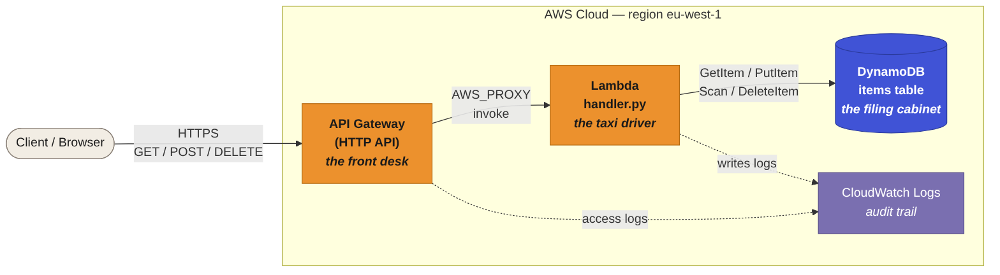

# Serverless Items API — Terraform on AWS

A small, production-shaped REST API provisioned entirely with **Terraform**,
running fully **serverless** on AWS: **API Gateway → Lambda → DynamoDB**. No
servers to patch, pay-per-use pricing, and the whole thing lives in the AWS
free tier for normal portfolio traffic.

This repo is built to be *read*, not just run. Every `.tf` file is commented in
plain language, and the [`theory/`](theory/) folder explains the concepts from
scratch — what "infrastructure as code" means, what "serverless" means, and how
these three AWS services fit together.

> **One-line summary for a CV or interview:** *"I wrote Terraform that stands up
> a serverless REST API on AWS — API Gateway, Lambda, and DynamoDB — with
> least-privilege IAM, encryption at rest, request logging, and a GitHub Actions
> pipeline that formats, validates, plans, and applies it."*

---

## Architecture



A request flows left to right and back:

1. A client sends an HTTPS request (`GET /items`, `POST /items`, …).
2. **API Gateway** (the front desk) receives it and forwards it to Lambda.
3. **Lambda** (`handler.py`, the worker) runs the logic for that route.
4. **DynamoDB** (the data store) saves or returns the item.
5. **CloudWatch** records logs from both API Gateway and Lambda for auditing.

Each component only runs for the milliseconds it is needed, which is why the
idle cost is effectively zero.

The diagram source is [`docs/architecture.mmd`](docs/architecture.mmd) (Mermaid).
Re-render it with `mmdc -i docs/architecture.mmd -o docs/architecture.png`.

---

## What it does (API)

| Method & route      | Purpose                     | Example body            |
|---------------------|-----------------------------|-------------------------|
| `GET /health`       | Liveness check              | —                       |
| `GET /items`        | List all items              | —                       |
| `POST /items`       | Create an item              | `{"text": "buy milk"}`  |
| `GET /items/{id}`   | Fetch one item              | —                       |
| `DELETE /items/{id}`| Delete one item             | —                       |

Once deployed, Terraform prints the base URL. Example calls:

```bash
API=$(terraform -chdir=terraform output -raw api_base_url)

curl $API/health
curl -X POST $API/items -d '{"text":"my first note"}'
curl $API/items
```

---

## Deploy it yourself

### Prerequisites
- An AWS account (the [free tier](https://aws.amazon.com/free/) is enough).
- [Terraform](https://developer.hashicorp.com/terraform/install) ≥ 1.6.
- AWS credentials configured locally (`aws configure`, or environment
  variables `AWS_ACCESS_KEY_ID` / `AWS_SECRET_ACCESS_KEY`).

### Steps
```bash
cd terraform
terraform init      # download the AWS provider
terraform fmt       # tidy formatting
terraform validate  # check the config is well-formed
terraform plan      # PREVIEW what will be created — read this carefully
terraform apply     # create it for real (type 'yes' to confirm)
```

### Tear it all down (stop any charges)
```bash
terraform destroy
```
Because every resource is in code, teardown is one command and leaves nothing
behind. This is the single biggest safety advantage of infrastructure as code.

> **You do not have to `apply` to learn from this project.** `terraform plan`
> shows the full set of resources without creating anything or costing a cent.
> The CI pipeline runs `fmt`, `validate`, and `plan` on every change.

---

## Cost estimate

Pricing below is **eu-west-1 (Ireland)**, on-demand, as published on the AWS
pricing pages (links in [theory/05-costs.md](theory/05-costs.md)). Serverless
means **you pay per request, not per hour** — an idle API costs ~$0.

### The AWS Free Tier (covers a portfolio project completely)

| Service       | Always-free / 12-month allowance            | This project's use |
|---------------|---------------------------------------------|--------------------|
| Lambda        | 1,000,000 requests + 400,000 GB-s / month (always free) | Far under |
| API Gateway   | 1,000,000 HTTP API requests / month (first 12 months) | Far under |
| DynamoDB      | 25 GB storage + 25 WCU/25 RCU (always free) | Far under |
| CloudWatch    | 5 GB logs ingested / month (always free)    | Far under |

**Realistic monthly bill for a portfolio demo: $0.00.**

### If this went to light production (beyond the free tier)

Assume **100,000 requests/month**, each a tiny read or write:

| Service      | Rate (eu-west-1, on-demand)                  | 100k req/month |
|--------------|----------------------------------------------|----------------|
| API Gateway  | $1.00 per million requests                    | **$0.10** |
| Lambda       | $0.20 per million requests + $0.0000000017/GB-ms at 128 MB | **< $0.05** |
| DynamoDB     | $1.25 per million writes, $0.25 per million reads (on-demand) | **< $0.13** |
| CloudWatch   | $0.50 per GB ingested (tiny log volume)       | **< $0.05** |
| **Total**    |                                              | **≈ $0.30 / month** |

The takeaway worth saying in an interview: **this architecture scales its cost
with usage, down to zero.** A traditional always-on server (EC2) for the same
API would cost **~$8–15/month even while doing nothing**.

Figures are estimates; confirm current rates with the
[AWS Pricing Calculator](https://calculator.aws/).

---

## Security

Security is documented separately and in depth in [`SECURITY.md`](SECURITY.md).
In short, this project applies: **least-privilege IAM** (the Lambda can touch
only its one table, with only four named actions), **encryption at rest** on
DynamoDB, **no hard-coded secrets**, **request/access logging** to CloudWatch,
and a **short log retention** window. Known limitations (e.g. the API is public
and unauthenticated by default) are listed honestly in that file, with the fix
for each.

---

## Repo layout

```
.
├── README.md                 you are here
├── SECURITY.md               security considerations + known limitations
├── terraform/                all infrastructure as code
│   ├── versions.tf           tool & provider version pins
│   ├── main.tf               provider, tags, account lookups
│   ├── variables.tf          settings (region, names)
│   ├── dynamodb.tf           the data store
│   ├── iam.tf                least-privilege permissions
│   ├── lambda.tf             the function + its log group
│   ├── api_gateway.tf        the public HTTP API + routes
│   └── outputs.tf            the URL and names printed after apply
├── src/
│   └── handler.py            the Lambda function (Python, no dependencies)
├── docs/
│   ├── architecture.mmd      diagram source (Mermaid)
│   └── architecture.png      rendered diagram
├── theory/                   plain-language explanations, start at 01
└── .github/workflows/
    └── terraform.yml         CI/CD: fmt, validate, plan, apply
```

---

## What I learned building this

- **Infrastructure as code** turns "click 40 buttons and hope" into a reviewable
  file that builds the same thing every time and tears down in one command.
- **Least-privilege IAM** is a mindset: start from *zero* permissions and add
  only the exact actions needed, scoped to the exact resource.
- **Serverless cost modelling** — why pay-per-request beats always-on for
  spiky or low-traffic workloads, and how to read an AWS pricing page.

*Built by [halemaa](https://github.com/halemaa) as a DevOps portfolio project.*
