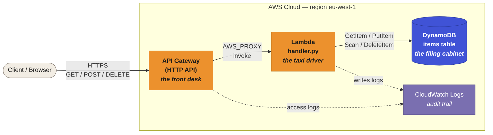

# 4. The architecture, end to end

Let's follow **one request** through the whole system. Say someone runs:

```bash
curl -X POST https://abc123.execute-api.eu-west-1.amazonaws.com/items \
     -d '{"text":"buy milk"}'
```



### Step 1 — API Gateway (the front desk) receives it
The request arrives over HTTPS at API Gateway. It matches the method + path
(`POST /items`) against its list of **routes**
([`api_gateway.tf`](../terraform/api_gateway.tf)). It's a known route, so it
forwards the request to the Lambda via the "integration" (the wire between
them).

### Step 2 — Lambda (the chef) does the work
AWS wakes up our function ([`src/handler.py`](../src/handler.py)) and hands it an
**event** describing the request. The code looks at `routeKey` (`"POST /items"`),
sees it's a create, reads the JSON body, builds an item with a fresh `id` and a
timestamp, and calls DynamoDB's `put_item`.

### Step 3 — DynamoDB (the pantry) stores it
The item is written to the table. DynamoDB confirms. The Lambda builds an HTTP
`201 Created` response with the new item and returns it.

### Step 4 — back out the same way
The response travels Lambda → API Gateway → back to the client's `curl`.

### Step 5 — logs (the audit trail)
Along the way, API Gateway wrote an access-log line (who, what, status, how
long) and the Lambda wrote its own execution logs, both to **CloudWatch**. If
anything had failed, these logs are where you'd look.

## Who's allowed to do what
Crucially, the Lambda could only write to DynamoDB because its **IAM role**
([`iam.tf`](../terraform/iam.tf)) explicitly grants `dynamodb:PutItem` on *that
one table*. And API Gateway could only call the Lambda because of an explicit
`aws_lambda_permission`. Nothing in AWS can talk to anything else unless a
permission says so — this "deny by default" is the foundation of cloud security.

## The whole thing is ~150 lines of Terraform
That's the point worth sitting with: a public, encrypted, logged, least-
privilege REST API — the kind of thing that used to need a rack of servers — is
now a small, readable set of text files that builds in about a minute and tears
down in one command.

Next: [how the costs work →](05-costs.md)
